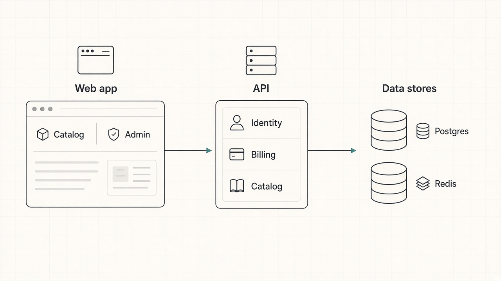
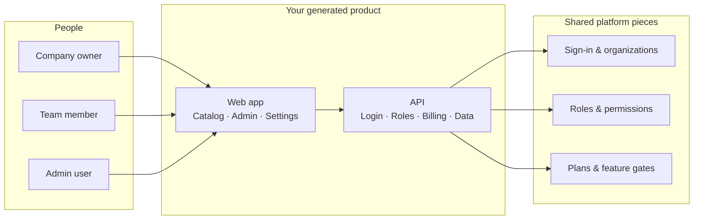
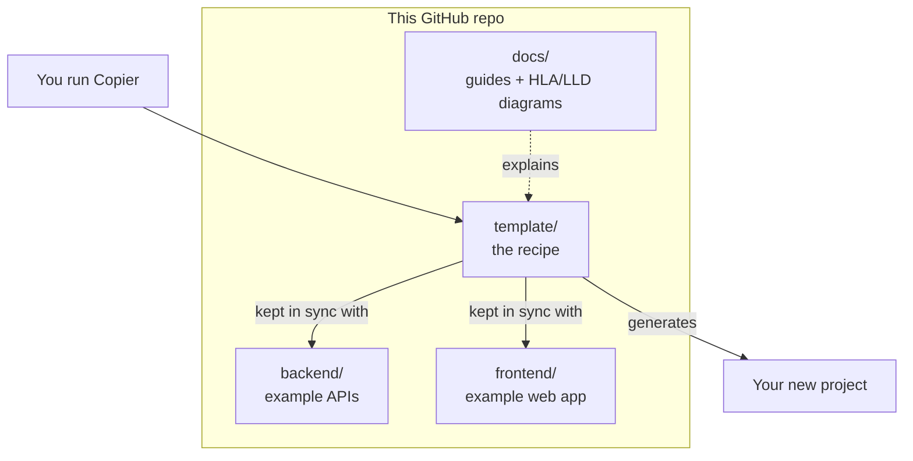

# Aham

**A starter kit for building multi-company (SaaS) products** — with login, organizations, roles, billing hooks, and a sample business UI already wired up.

You do not start from a blank repo. You generate a **backend API**, a **web app**, or both from one template, then customize the product parts. This repository also keeps working **examples** and a full **documentation site**.

<p align="center">
  
</p>

<p align="center"><em>Users use the web app → the API enforces access and business rules → data lives in Postgres (with Redis for sessions and entitlements).</em></p>

---

## What is this, in plain language?

| Question | Answer |
|---|---|
| **What problem does it solve?** | Standing up a serious SaaS product usually means reinventing auth, tenants, permissions, billing gates, and UI structure. Aham packages those once. |
| **Who is it for?** | Product teams and platform leads who want a consistent way to spin up APIs and admin/catalog-style UIs — and keep examples honest as the template evolves. |
| **What do you get?** | A Copier template + runnable examples (API + SPA) + docs with architecture diagrams. |
| **What do you still build?** | Your domain (orders, inventory, whatever). The spine (identity, tenancy, billing, UI modules) is already there. |

Think of it as a **factory floor for SaaS apps**: the building, power, and security desk are installed; you furnish the rooms.

---

## What you can open on day one



**Example screens already in the SPA**

- **Catalog** — categories and items (a realistic CRUD product surface)
- **Admin** — invite users, manage roles/permissions, view plans & subscription
- **Settings** — theme, language (en/ja), density

**Example capabilities already in the API**

- Register / login / switch organization
- Invite members, change roles, custom tenant roles
- Plans, entitlements, optional Stripe checkout
- Tenant-isolated catalog data

---

## How this repository is organized



| Folder | Plain-English role |
|---|---|
| [`template/`](template/) | The **source of truth** — choose backend or frontend when you generate |
| [`backend/`](backend/) | **Worked examples** of generated APIs (including a full SaaS monolith) |
| [`frontend/`](frontend/) | **Worked example** SPA (`web-spa`) with catalog + admin |
| [`docs/`](docs/) | Human docs site (architecture HLA/LLD, how-tos, API map) |
| [`assets/`](assets/) | Images used in this README |

---

## Generate a project

```bash
uvx copier copy --trust ./template my-new-project
# choose stack=backend  or  stack=frontend
```

Later improvements:

```bash
uvx copier update --trust
```

### Quick local tour (examples in this repo)

```bash
# API (needs Docker for Postgres + Redis)
cd backend/mono-monolith
docker compose up -d postgres redis
uv sync --all-packages
uv run dx db upgrade core-api
uv run dx run core-api          # http://localhost:8001/docs

# Web app
cd frontend/web-spa
pnpm install && pnpm dev        # http://localhost:5173
# or UI-only with mocks: VITE_AUTH_MODE=dev VITE_USE_MOCKS=1 pnpm dev
```

---

## Example matrix (for tech leads)

| Path | What it demonstrates |
|---|---|
| `backend/mono-monolith` | Full SaaS spine: identity, billing, catalog, Redis, initial Alembic migration |
| `backend/mono-micro-kafka-nx` | Microservices + Kafka + Nx |
| `backend/mono-micro-moon` | Microservices + moon |
| `backend/poly-kit` | Shared platform-kit package |
| `backend/poly-service-kafka` | Standalone service pinned to the kit |
| `frontend/web-spa` | SPA modules: catalog + admin, SaaS auth or MSW mocks |

More detail: [template/README.md](template/README.md) · [template/HANDOFF.md](template/HANDOFF.md)

---

## Documentation

Architecture diagrams (HLA/LLD), API tables, and frontend module guides:

```bash
cd docs
npm install
npm start    # http://localhost:3000
```

Start here in the docs: **[Architecture (HLA / LLD)](docs/docs/getting-started/architecture.mdx)** · **[Getting started](docs/docs/getting-started/overview.mdx)** · **[Introduction](docs/docs/intro.mdx)**

---

## Design principles (short)

1. **Product teams write product code** — platform baselines stay protected.
2. **Same shapes everywhere** — modules on the API, modules→features in the UI.
3. **Examples must match the template** — `./scripts/check-examples.sh` fails on drift.
4. **SaaS by default** — organizations, roles, and billing gates are first-class, not bolted on later.
