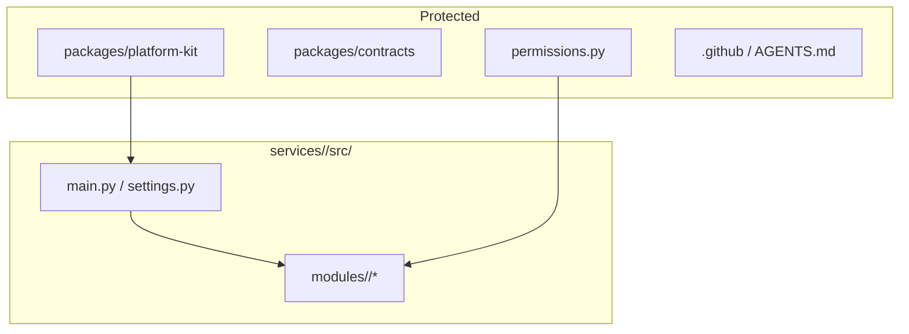
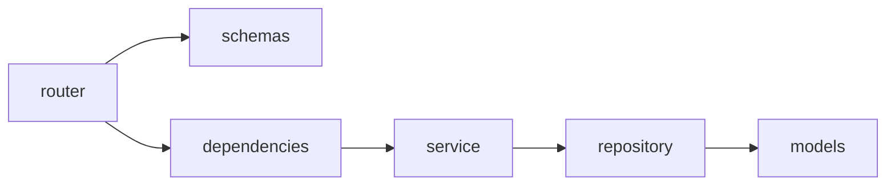

# Architecture

System-wide HLA/LLD diagrams live in [Getting started → Architecture](../getting-started/architecture.mdx). This page is the **backend LLD**.

## Protected vs product



Also protected: `.claude/`, `.cursor/`, root `pyproject.toml`. Services never import each other — use `ServiceClient`.

## Module layers



| File | Rules |
|---|---|
| `router.py` | `SecureRouter`; ≤ 6 statements; parse → service → schema |
| `schemas.py` | Pydantic only |
| `service.py` | No FastAPI; raise `AppError`s; `await self.repo.commit()` once |
| `repository.py` | `BaseRepository`; flush only |
| `models.py` | SQLAlchemy only |
| `dependencies.py` | Only place that combines layers |
| Optional | `errors`, `events`, `constants`, `phase2`, `scim_router` |

## Import bans

- router ↛ repository / models / sqlalchemy
- service ↛ fastapi
- repository ↛ service / schemas / fastapi
- Cross-module: only via `service` / `schemas` / `errors`

## Errors

Raise: `NotFoundError`, `ConflictError`, `ForbiddenError`, `UnauthorizedError`, `BadRequestError`, `UnprocessableError`, `ExternalServiceError` (+ `PaymentRequiredError` in kit).

Envelope:

```json
{"error": {"code": "...", "message": "...", "request_id": "...", "fields": {}, "debug": {}}}
```

No `HTTPException`, no bare `except: pass` (`ERR001`/`ERR002`).

## Logging

```python
log = get_logger(__name__)
log.info("item_created", item_id=str(item.id))
```

No `print` / `logging.getLogger` (`LOG001`/`LOG002`).
