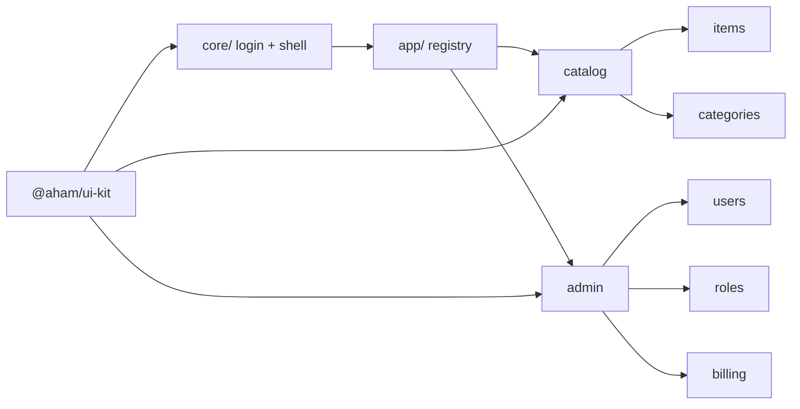

# Frontend overview

Vite + React **ERP SPA** on `@aham/ui-kit`. Product code is organised as **modules → features** (not a flat `features/` folder).


## Stack

| Piece | Choice |
|---|---|
| Bundler | Vite 6 (`:5173`, alias `@` → `src`, **no proxy**) |
| UI | React 19 + TypeScript |
| Routing | TanStack Router |
| Data | TanStack Query |
| Forms | zod + kit `useZodForm` |
| Styling | Tailwind 4 + curated shadcn primitives |
| i18n | i18next (`en` / `ja`) |
| Mocks | MSW (`VITE_USE_MOCKS=1`) |
| Packages | pnpm workspace |
| Node | ≥ 20 |

## Tree

```text
apps/web/src/
  app/                 # PROTECTED: router, providers, registry
  core/                # PROTECTED: login, shell, home, settings, errors
  lib/                 # api client, auth helpers, i18n, MSW bootstrap
  modules/<module>/    # product modules (catalog + admin)
packages/ui-kit/       # @aham/ui-kit
nginx/                 # production SPA image
```



Registry auto-discovers `modules/*/module.ts` via `import.meta.glob`. Full HLA/LLD: [Architecture](../getting-started/architecture.mdx).

## Commands

```bash
cd frontend/web-spa
pnpm install
pnpm dev
pnpm dx check
pnpm new-module inventory
pnpm new-feature inventory/skus
pnpm gen-api http://localhost:8001/openapi.json
pnpm test
pnpm --filter ./apps/web build
```

## Section map

| Page | Contents |
|---|---|
| [Modules](./modules.mdx) | Folder contract + import matrix |
| [UI kit](./ui-kit.mdx) | Exports, layers, AppShell |
| [Auth](./auth.mdx) | saas vs dev, storage, MFA/SSO |
| [Routing](./routing.mdx) | Route table + guards |
| [Catalog](./catalog.mdx) | items + categories reference |
| [Admin](./admin.mdx) | users, roles, billing |
| [API](./connecting-api.mdx) | Env + client |
| [Mocks](./mocks.mdx) | MSW |
| [Theming & i18n](./theming-i18n.mdx) | Preferences |
| [dx check](./dx-check.mdx) | FE-* codes |
| [Testing](./testing.mdx) | Vitest / Playwright / Storybook |

Golden patterns live in `frontend/web-spa/CONVENTIONS.md`.
