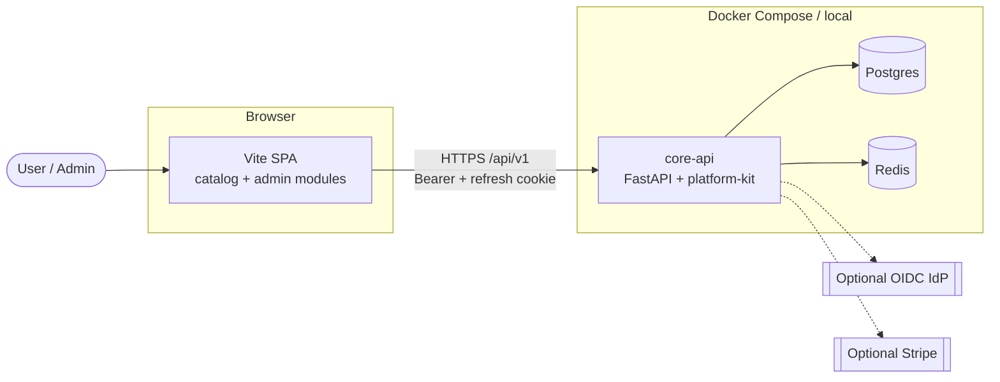
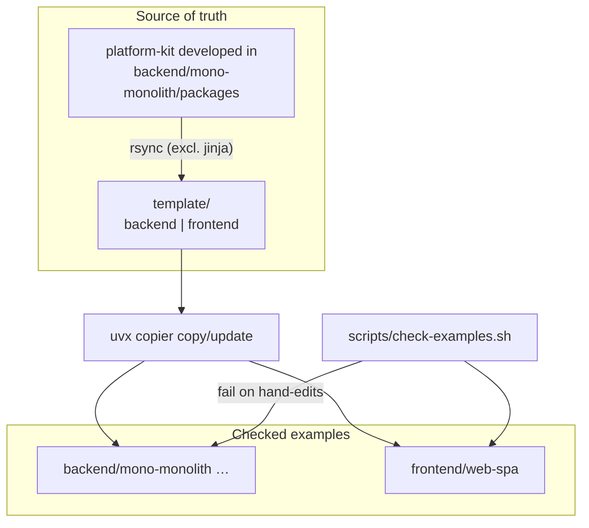
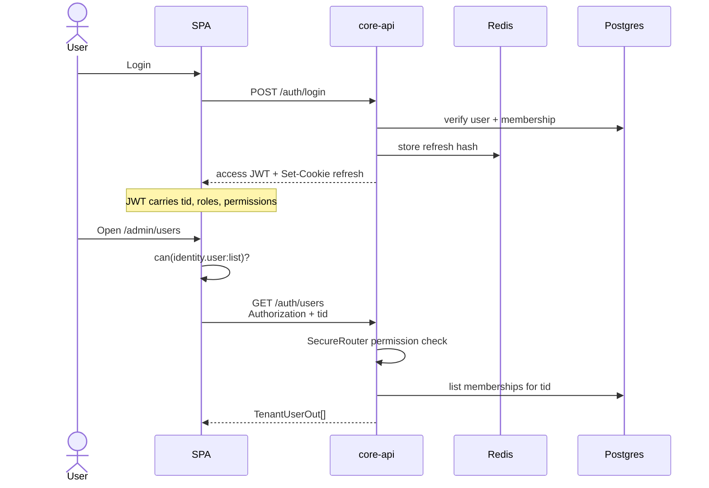
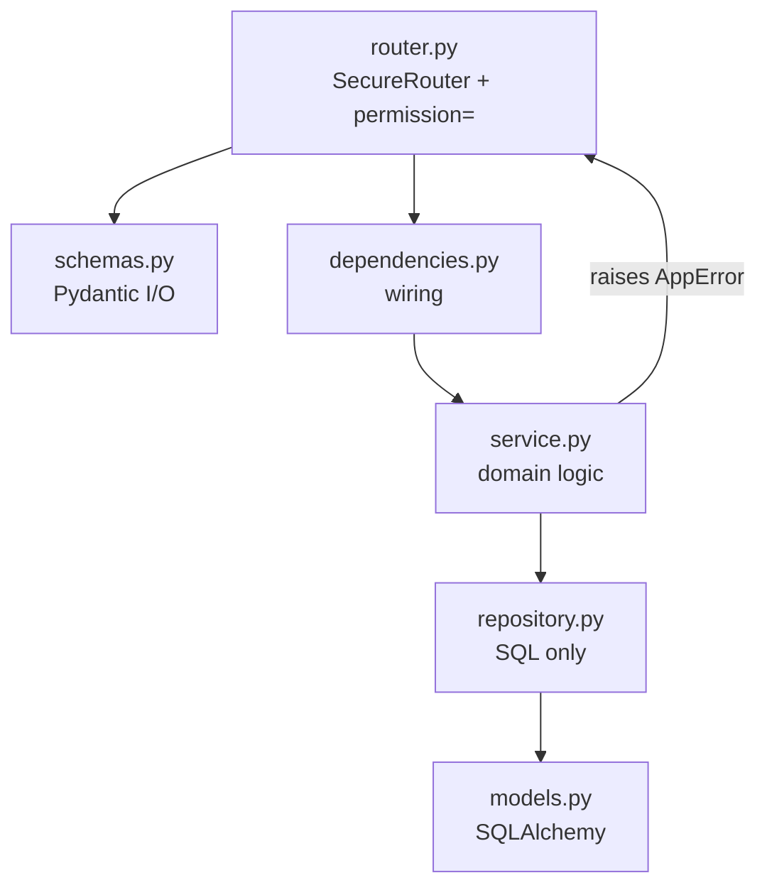
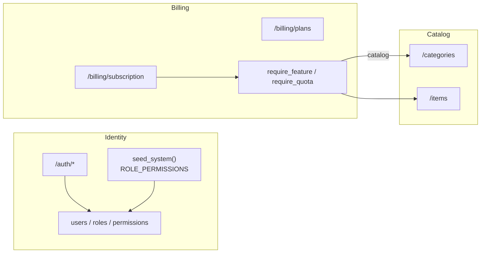
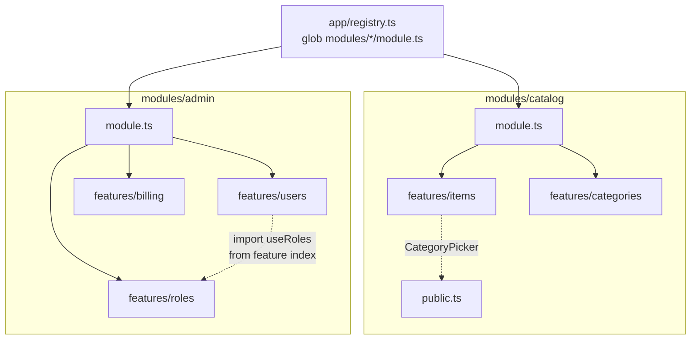
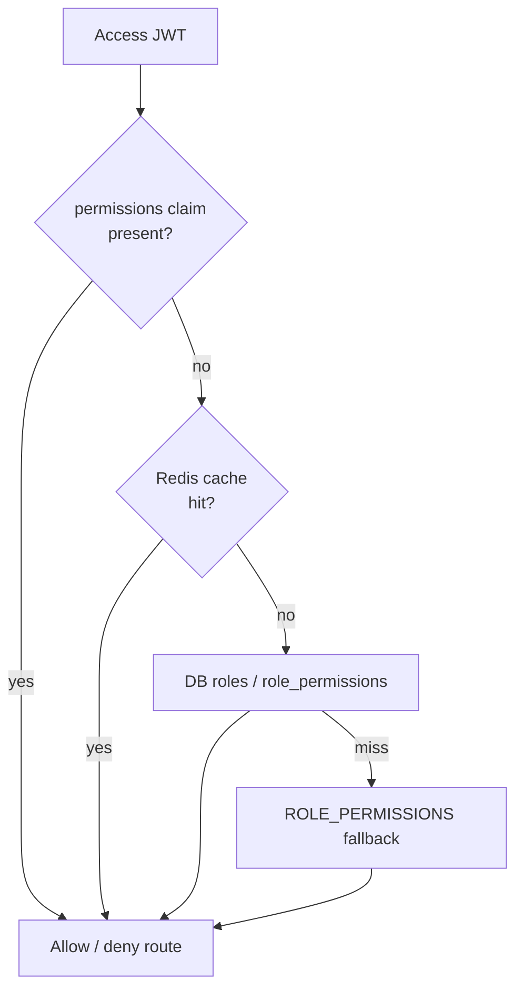

# Architecture

High-level (HLA) and low-level (LLD) views of how the Aham template fits together when you run the **SaaS monolith + SPA** pairing (`backend/mono-monolith` + `frontend/web-spa`).

## HLA — system context

| Piece | Role |
|---|---|
| SPA | ERP shell; product modules (`catalog`, `admin`); TanStack Query |
| core-api | Identity, billing, showcase catalog; RBAC on every route |
| Postgres | Tenants, users, roles, plans, catalog tables (+ RLS on catalog) |
| Redis | Refresh tokens, permission cache, entitlement snapshots |

## HLA — meta-repo (template → examples)

## HLA — request path (authenticated SaaS)

## LLD — backend module layers

Rules of thumb:

- Router ≤ 6 statements: parse → service → return schema
- Service never imports FastAPI; repository never imports schemas
- Cross-module only through another module’s `service` / `schemas` / `errors`

## LLD — SaaS spine inside the monolith

## LLD — frontend modules → features

Each feature owns `api/` · `hooks/` · `model/` · `views/` · `routes/` · `locales/`. Nav and route guards use the same permission strings as the API (`core-api.item:list`, `identity.user:list`, …).

## LLD — permission resolution

## Where to dig deeper

| Topic | Doc |
|---|---|
| Backend layers & errors | [Backend architecture](../backend/architecture.mdx) |
| Route tables | [API reference](../backend/api-reference.mdx) |
| RBAC resources | [Permissions](../backend/permissions.mdx) |
| SPA modules | [Frontend modules](../frontend/modules.mdx) |
| Admin UI | [Admin module](../frontend/admin.mdx) |
| Catalog UI | [Catalog module](../frontend/catalog.mdx) |
