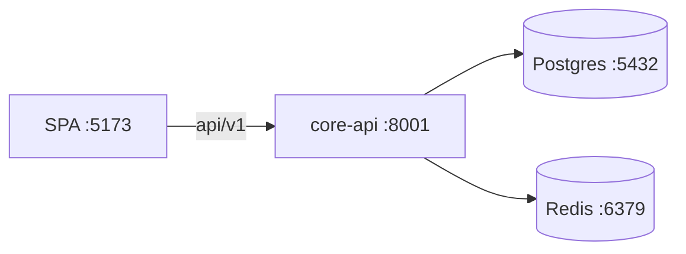

# Local development




## Backend — mono-monolith (SaaS)

```bash
cd backend/mono-monolith
cp .env.example services/core-api/.env
uv sync --all-packages
docker compose up -d postgres redis
uv run dx db upgrade core-api   # applies initial Alembic revision (identity/billing/catalog)
uv run dx run core-api
```

| Endpoint | URL |
|---|---|
| API | `http://localhost:8001` → container `8000` |
| OpenAPI | `http://localhost:8001/docs` |
| OpenAPI JSON | `http://localhost:8001/openapi.json` |
| Liveness | `/health/live` |
| Readiness | `/health/ready` |
| Jaeger | `dx up --observability` → `:16686` |

```bash
uv run dx token core-api --all          # mint a JWT with all permissions
uv run dx token core-api --perm 'core-api.item:list' --sub alice
```

Important env (service `.env`):

```bash
PLATFORM_PROFILE=saas
REDIS_URL=redis://localhost:6379/0
JWT_ISSUER=https://auth.local
JWT_AUDIENCE=api://local
CORS_ORIGINS=["http://localhost:5173"]
FRONTEND_URL=http://localhost:5173
REFRESH_COOKIE_SECURE=false   # local HTTP
```

Tests often set `DB_AUTO_CREATE=true`. For Docker / prod-like runs, leave it off and use Alembic (`DB_AUTO_CREATE` is forbidden in prod).

## Backend — Kafka variants

```bash
cd backend/mono-micro-kafka-nx
cp .env.example services/core-api/.env
docker compose up -d postgres kafka
# KAFKA_BOOTSTRAP_SERVERS=localhost:29092  (host clients)
uv run dx run core-api
```

| Network | Bootstrap |
|---|---|
| Host | `localhost:29092` |
| Containers | service DNS + internal `9092` |

## Frontend — web-spa (SaaS against monolith)

```bash
cd frontend/web-spa
cp .env.example .env
# VITE_API_BASE_URL=http://localhost:8001/api/v1
# VITE_AUTH_MODE=saas
# VITE_DEFAULT_LOCALE=en
pnpm install
pnpm dev    # :5173
```

Exercise `/catalog/items`, `/catalog/categories`, and `/admin/{users,roles,billing}` after registering a tenant (or minting a token with the matching permissions).

## Frontend — UI-only with MSW

```bash
# .env
VITE_AUTH_MODE=dev
VITE_USE_MOCKS=1
pnpm mocks:init   # once — writes public/ mockServiceWorker.js
pnpm dev
```

MSW covers catalog + admin handlers (`lib/mocks.ts`).

## Quality gates

### Backend

```bash
uv run dx fmt && uv run dx lint --service core-api
uv run dx test --service core-api && uv run dx check
```

### Frontend

```bash
pnpm format:check && pnpm typecheck && pnpm lint
pnpm dx check && pnpm test && pnpm --filter ./apps/web build
```

### Meta-repo

```bash
./scripts/check-examples.sh
```

## Ports cheat sheet

| Service | Port |
|---|---|
| core-api (host) | 8001 |
| Postgres | 5432 |
| Redis | 6379 |
| Kafka (host) | 29092 |
| Jaeger UI | 16686 |
| SPA | 5173 |
| Storybook (ui-kit) | 6006 |
