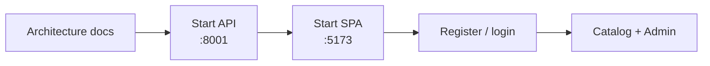

# Getting started


## Prerequisites

| Stack | Tools |
|---|---|
| Backend | [uv](https://docs.astral.sh/uv/), Python 3.12+, Docker Compose, Copier ≥ 9.4 (`uvx copier`) |
| Frontend | Node ≥ 20, pnpm, Copier ≥ 9.4 |
| Docs | Node ≥ 20 (`cd docs && npm install`) |

## Two ways to explore

1. **Run the examples** in this repo (`backend/mono-monolith` + `frontend/web-spa`) — fastest for learning.
2. **Generate a fresh project** from `./template` — use for real work.

```bash
uvx copier copy --trust ./template my-new-project
# stack: backend | frontend
```

## Recommended first path (SaaS end-to-end)



1. Skim [Architecture (HLA / LLD)](./architecture.mdx) and [Tech stack](./tech-stack.mdx)
2. Start **mono-monolith** (Postgres + Redis + `core-api` on `:8001`)
3. Start **web-spa** with `VITE_AUTH_MODE=saas` and `VITE_API_BASE_URL=http://localhost:8001/api/v1`
4. Open API docs at `http://localhost:8001/docs` and SPA at `http://localhost:5173`
5. Register / login / switch tenant in the SPA; exercise `/catalog/items`, `/catalog/categories`, and `/admin/users`

Details: [Local development](./local-dev.mdx).

## UI-only (no backend)

```bash
cd frontend/web-spa
# .env: VITE_AUTH_MODE=dev and VITE_USE_MOCKS=1
pnpm install && pnpm dev
```

MSW serves in-memory catalog (`/items`, `/categories`) and admin (`/auth/*`, `/billing/*`) handlers per tenant header.
