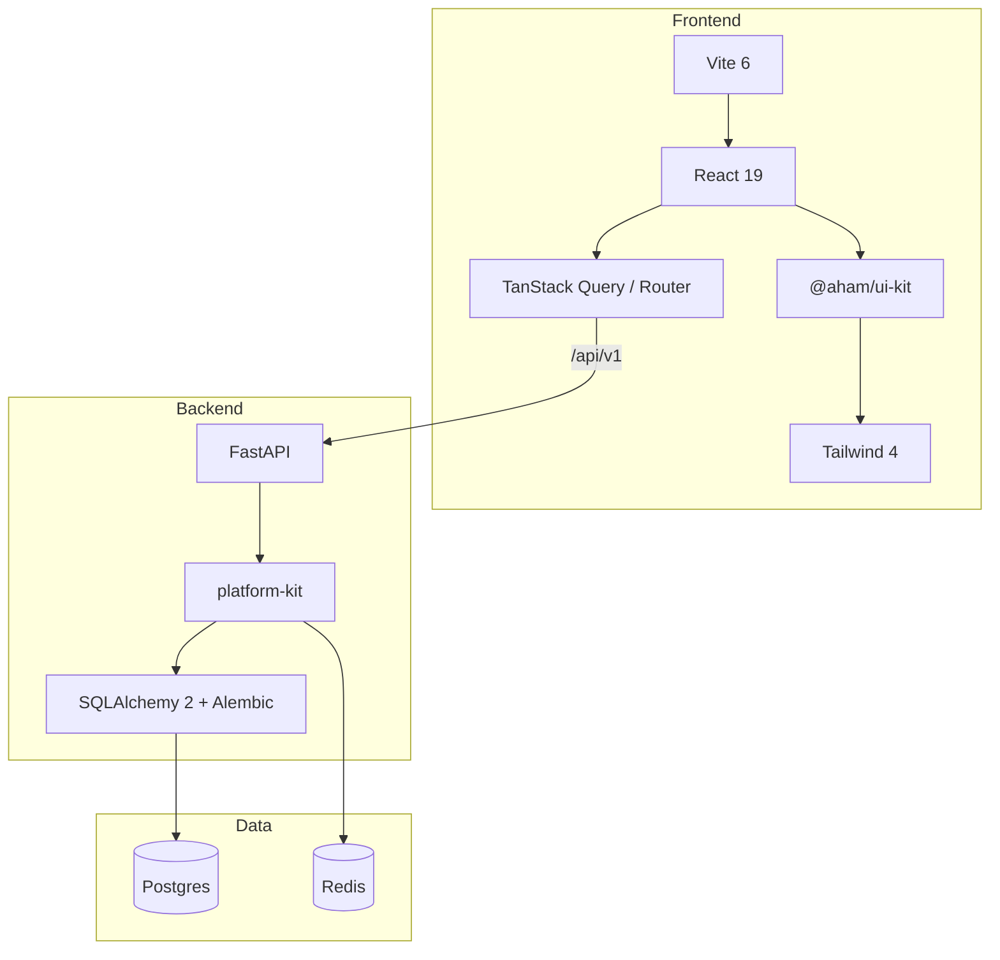

# Tech stack

Visual overview of the frameworks and packages Aham ships with. Logos load from [skillicons](https://skillicons.dev) / Shields.io (same set as the root README).

*Web app → API → Postgres + Redis*

## Logos

  

  
  
  
  
  
  
  
  

## How the pieces connect

## Backend packages

| Area | Choices |
|---|---|
| Language | Python ≥ 3.12 · **uv** workspaces |
| HTTP | **FastAPI** + Uvicorn |
| Data | **SQLAlchemy 2** async · **Alembic** · **PostgreSQL** · **Redis** (SaaS) |
| Validation | **Pydantic** / Settings |
| Messaging (optional) | **Kafka** + FastStream + outbox |
| Quality | **Ruff** · **Pyright** · **pytest** · **pre-commit** · `dx` |
| Ship | **Docker Compose** |

## Frontend packages

| Area | Choices |
|---|---|
| Language | **TypeScript** · Node ≥ 20 · **pnpm** |
| App | **Vite 6** · **React 19** |
| Data / routes | **TanStack** Router, Query, Table |
| Forms | **react-hook-form** · **Zod** |
| UI | **Tailwind 4** · **`@aham/ui-kit`** |
| i18n | **i18next** (`en` / `ja`) |
| Mocks / tests | **MSW** · Vitest · Playwright |

## Template & docs

| Area | Choices |
|---|---|
| Generator | **Copier** |
| Docs | **Docusaurus** + Mermaid |
| Optional | **Nx** / **moon** |

Next: [Architecture (HLA / LLD)](./architecture.mdx) · [Local development](./local-dev.mdx)
