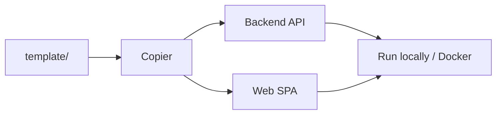

# Aham

**Aham** is a starter kit for multi-company (SaaS) products: login, organizations, roles, billing hooks, and a sample business UI — packaged as a **Copier template**, with working **examples** and this **docs site**.

*Users use the web app → the API enforces access and rules → data lives in Postgres (Redis holds sessions and entitlements).*

## In one picture: recipe → product

*Pick backend or frontend from the template, generate a project, then customize your domain.*

## Mental model

| Who | Owns | Writes |
|---|---|---|
| Platform leads | `platform-kit` / `@aham/ui-kit` | Baseline only (`DX_ALLOW_BASELINE=1`) |
| Product teams | Services / modules / features | Domain code via `dx` generators |
| Copier | Project shape | Answers in `.copier-answers.yml` |

Wrong structure fails in the editor (hooks), at commit (`dx check`), and in CI — including `./scripts/check-examples.sh`.

## What ships in the example product

| Surface | Purpose |
|---|---|
| **Catalog** | Categories + items (tenant-scoped CRUD) |
| **Admin** | Users, roles/permissions, plans & subscription |
| **Settings** | Theme, language (en/ja), density |

## Stacks at a glance

### Backend

- Python 3.12+, FastAPI, SQLAlchemy 2 async, Alembic, uv, Ruff, Pyright
- Layouts: monorepo monolith | microservices | polyrepo kit | polyrepo service
- Optional Kafka (FastStream + outbox + contracts)
- Default **SaaS spine**: local IdP, Redis refresh, tenancy, entitlements, IAM admin APIs, billing; Phase 2 SSO/SCIM/API keys/MFA; optional Stripe
- Showcase catalog: tenant-scoped `categories` + `items` with `require_feature("catalog")`

### Frontend

- Vite 6, React 19, TanStack Router/Query, Tailwind 4, pnpm
- **ERP layout**: `modules/<module>/features/<feature>/`
- Real **SaaS auth** or **dev** mock + MSW
- Reference modules: **catalog** and **admin**

Full package list with logos: [Tech stack](./getting-started/tech-stack.mdx).

## Example matrix

| Path | Shape |
|---|---|
| `backend/mono-monolith` | Monolith + identity/billing/categories/items + Redis + initial Alembic |
| `backend/mono-micro-kafka-nx` | Micro + Kafka + Nx (+ contracts) |
| `backend/mono-micro-moon` | Micro + moon (HTTP only) |
| `backend/poly-kit` | Publishes platform-kit + contracts |
| `backend/poly-service-kafka` | Flat service pinning the kit |
| `frontend/web-spa` | SPA + catalog + admin + SaaS auth |

:::tip Development rule
Edit **`template/`** (and develop kit code in `backend/mono-monolith/packages/platform-kit`, then rsync). Do not hand-edit examples long-term — regenerate and let `check-examples.sh` keep them honest.
:::

## Where to go next

- [Architecture (HLA / LLD)](./getting-started/architecture.mdx)
- [Tech stack](./getting-started/tech-stack.mdx)
- [Getting started](./getting-started/overview.mdx)
- [Backend](./backend/overview.mdx) · [Frontend](./frontend/overview.mdx) · [Template](./template/overview.mdx)
